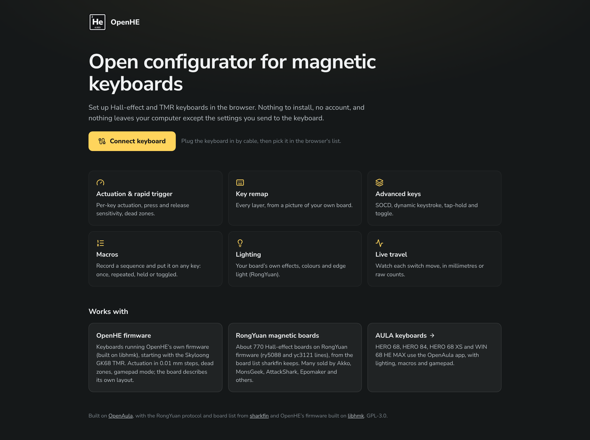
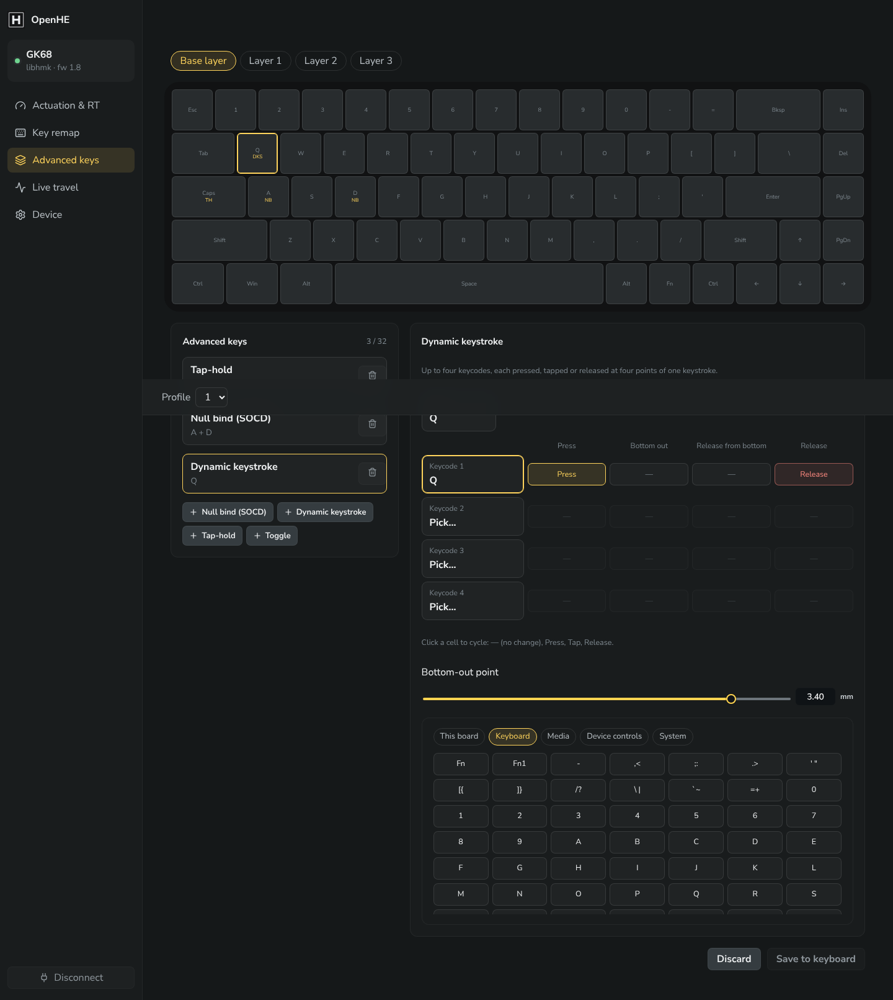

# OpenHE

An open, browser-based configurator for **magnetic (Hall-effect and TMR) keyboards**. Plug a keyboard in, open the page in Chrome or Edge, and set actuation, rapid trigger, key remaps and advanced keys from a picture of your own board. Nothing to install, no account, no telemetry: the page talks only to your keyboard.

OpenHE grew out of [OpenAula](https://github.com/shizunavn/OpenAula) and keeps its interface, adding a driver layer so one app can serve keyboards from different firmware families.



> **Unofficial project.** OpenHE is a community effort built on open firmware and reverse engineering. It is not affiliated with or endorsed by RongYuan, AULA, or any keyboard maker.

## Contents

- [Supported keyboards](#supported-keyboards)
- [Features](#features)
- [Quick start](#quick-start)
- [Help test a board](#help-test-a-board)
- [How it works](#how-it-works)
- [AULA keyboards (OpenAula)](#aula-keyboards-openaula)
- [Development](#development)
- [Project structure](#project-structure)
- [Credits and license](#credits-and-license)

## Supported keyboards

| Family | Boards | Status |
| --- | --- | --- |
| **OpenHE firmware** | Keyboards running OpenHE's own firmware, built on [libhmk](https://github.com/peppapighs/libhmk) (see [gk68tmr_firmware](https://github.com/bharathanand0/gk68tmr_firmware)), starting with the Skyloong GK68 TMR. The board reports its own layout, so no per-board setup is needed. It is not hmkconf-compatible: the firmware has its own actuation model (0.01 mm steps, dead zones, OpenAula-style rapid trigger) and its own HID usage page. | Keymap, actuation, rapid trigger, dead zones, advanced keys, live travel, calibration, gamepad |
| **RongYuan** | About 770 magnetic boards on RongYuan firmware, sold under Akko, MonsGeek, AttackShark, Epomaker, Hator, Ajazz, YUNZII and many other names. Board list, layouts and protocol from [sharkfin](https://github.com/dniminenn/sharkfin). | Keymap and Fn layer on all of them; switch settings read on all, **written** on the ry5088 and yc3121 firmware lines (the ones whose write path is verified) |
| **AULA** | HERO 68, HERO 84, HERO 68 XS, WIN 68 HE MAX | Through the original OpenAula app, linked from the start screen |

RongYuan boards are identified by the ID the board reports, not by USB product ID (many unrelated boards share `3151:5030`). A board missing from the list is reported as such; nothing is guessed.

## Features

| Area | What you can do |
| --- | --- |
| Quick Settings, Actuation, Rapid Trigger | OpenAula's own pages: per-key or multi-key actuation point, rapid trigger, top and bottom dead zones (where the board has them), with live Visual Feedback, in 0.01 mm steps |
| Rapid Trigger | On/off per key, one sensitivity or separate press and release sensitivities, continuous rapid trigger on OpenHE firmware |
| Key Remap | Every layer, from a picture of your board; the catalog is filtered to what the board can store, plus board-specific keys (layers, profiles, bootloader …) |
| Actuation extras | Release point with Rapid Trigger off (RongYuan) |
| Advanced Keys | Null bind / SOCD (5 resolution rules and bottom-out override), dynamic keystroke (4 keycodes × 4 stages), tap-hold, toggle (OpenHE firmware), and macros on any key (both), shown with OpenAula's key icons |
| Macros | OpenAula's macro editor (record, edit timing, import/export); macros are kept on your computer and put on keys from Advanced Keys. Played once, N times, while held, or toggled. OpenHE firmware stores 128 steps per profile; RongYuan boards hold 50 macros of up to 250 bytes |
| Lighting | RongYuan: the board's own effect list (from the vendor's light table), brightness, speed, direction, colour or rainbow, the edge light where there is one, and backlight off on yc500 boards |
| General Settings | RongYuan: debounce, Windows key lock and WASD/arrow swap (yc500), system auto-detect; OpenHE firmware: polling rate, gamepad interface, advanced key timing |
| Gamepad | The firmware's XInput gamepad (OpenHE firmware): per-key button map, analog curve and stick options |
| Hall Stream | OpenAula's live travel page: every key's travel in mm (polled on OpenHE firmware, streamed by cable on RongYuan gen2) |
| Switch Selector | OpenAula's switch selector: tell the board which switch each key has. On OpenHE firmware up to 4 switch types at once, each with its own travel and curve, so mixed switches (e.g. Gravastar UFO and Skyloong Crystal Blue) read correct millimetres; on RongYuan boards the vendor's switch models where the board lists them |
| Device | Firmware version, layout source, recalibration, factory reset; confirming an inferred RongYuan layout before writes |
| Profiles | Every on-board profile the board has; RongYuan switch settings follow the active profile, as the firmware stores them |



## Quick start

There is no hosted copy of OpenHE yet, so run it from source. It needs **Node.js 22.12 or later**:

```sh
git clone -b claude/eager-ritchie-vp804h https://github.com/bharathanand0/OpenHE.git
cd OpenHE
npm ci
npm run dev
```

1. Open the HTTPS address Vite prints in **Chrome or Edge** on a desktop and accept the local certificate warning (WebHID needs a secure page and is not available in Firefox or Safari).
2. Plug the keyboard in **by cable** and click **Connect keyboard**.
3. Pick the keyboard in the browser's list. Close the vendor's own software first: only one app can own the settings channel at a time.
4. Change settings and press **Save to keyboard**.

On Linux the keyboard's HID node belongs to root; add a udev rule (sharkfin's [README](https://github.com/dniminenn/sharkfin#install) has one covering RongYuan vendor IDs) and replug.

## Help test a board

OpenHE is new and has mostly been checked against software models of the protocols. Reports from real boards are the most useful thing right now:

- **RongYuan owners:** does the picture match your board (Device page)? Do actuation and remap changes take effect and survive a replug? Include the name shown in the sidebar and the firmware version.
- **GK68 owners on OpenHE firmware:** whether actuation, rapid trigger and the dead zones feel the way the sliders say.

Open an issue on this repository with what you saw.

## How it works

Each keyboard family is a **driver** in `src/drivers/` behind one interface (`KeyboardDriver`). A driver reports what the board can do (`capabilities`: profiles, layers, travel range and step, which advanced keys, live travel, gamepad …) and its layout; the UI shows only what the board supports and always works in millimetres and one shared keycode space.

- `src/drivers/openhe/` speaks the OpenHE firmware's raw HID protocol (usage page `0xFF48`, libhmk's command set with OpenHE's actuation records). The board identifies itself with an `OPHE` signature; name, sizes, layout and default keymap come from its own metadata.
- `src/drivers/rongyuan/` is a TypeScript port of sharkfin's protocol: 64-byte feature reports on `0xFFFF`, both command families (gen2 and yc500), the magnetic switch columns, write pacing and the 2.4 GHz receiver relay. It writes only what sharkfin writes, with the same spacing between flash writes. `scripts/rongyuan-boards.py` regenerates the bundled board list and light tables from a sharkfin checkout.
- `src/driverApp/` is the workspace UI for driver-backed boards. The connected board is registered as an OpenAula board model, so OpenAula's own Quick Settings, Actuation Point, Rapid Trigger and Hall Stream pages and keyboard preview draw it.

Both drivers are tested in `tests/openhe-driver.test.mjs` and `tests/rongyuan-driver.test.mjs` against software boards built from the firmware sources and protocol notes.

## AULA keyboards (OpenAula)

The AULA app from OpenAula is still here, unchanged, behind the **AULA keyboards** card on the start screen (the choice is remembered; **OpenHE home** in its device panel goes back). For AULA boards, the Windows tray service, Custom Effects, Rhythm Sync and the AULA documentation, see [OpenAula](https://github.com/shizunavn/OpenAula) itself.

## Development

The separate public landing page lives in `landing/`. Build it with
`npm run build:landing`, check with `npm run check:landing`, and package it with
`npm run package:landing`. See [landing page development and deployment](landing/README.md).

Production builds and tests require development dependencies. Use `npm ci` (or
`npm ci --include=dev` if your environment defaults to omitting them) before
building; the resulting `dist/` contains static browser assets.

Copy `.env.example` to `.env.local` to configure `HERO68_DEV_HOSTS`: optional
comma-separated hostnames/IPs added to the local Vite certificate. Localhost and
127.0.0.1 remain available without configuration.

Set `HERO68_ALLOWED_ORIGINS` in the **service process environment** to allow
additional exact HTTP(S) origins, separated by commas. Paths, credentials and
wildcards are rejected. The service does not load Vite's `.env.local`; its
deployed Pages and localhost defaults remain available, and `--allow-origin`
still adds origins explicitly. These variables are not exposed to browser code.

| Command | Description |
| --- | --- |
| `npm run dev` | Start the Vite dev server over HTTPS |
| `npm run build` | Type-check and build the web app into `dist/` (serve it over HTTPS for WebHID) |
| `npm run preview` | Preview the production build |
| `npm test` | Run all tests (`node --test tests/*.test.mjs`) |
| `npm run test:rgb` | Run only the RGB tests |
| `npm run test:profile-remap` | Run only the profile/remap tests |
| `npm run typecheck:service` | Type-check the Windows service TypeScript without emitting |
| `npm run build:service` | Type-check and bundle the service's TypeScript into `service/dist/` |
| `npm run pages:deploy` | Build and deploy the web app to Cloudflare Pages (`open-aula.pages.dev`) |
| `npm run cf:dev` | Build and preview as a Cloudflare Worker locally |
| `npm run cf:deploy` | Build and deploy as a Cloudflare Worker |

Tech stack: React 19, TypeScript 7, Vite 8, WebHID; the service uses a bundled Node runtime with a native C++ launcher and HID bridge.

### Cloudflare deployment (Pages)

The deployment setup below is inherited from OpenAula and still targets its project names.

The web app is deployed to **Cloudflare Pages** at [https://open-aula.pages.dev/](https://open-aula.pages.dev/).

API endpoints (`/api/region` for language detection and `/api/health` for monitoring) are implemented via Cloudflare Pages Functions in `functions/api/`, which wrap the shared Worker handlers in `worker/`. Static frontend assets are compiled into `dist/`.

- **Automatic deployment via CI**: On every push to `main`, `.github/workflows/cloudflare.yml` runs TypeScript checks for both the service and the web app, builds the assets, and deploys directly to Cloudflare Pages using `wrangler pages deploy dist --project-name open-aula --branch main` when `CLOUDFLARE_API_TOKEN` and `CLOUDFLARE_ACCOUNT_ID` secrets are set. Pull requests from forks skip deployment.
- **Manual deployment via CLI**:
  ```sh
  npm run pages:deploy
  ```
- **Local preview / Workers mode**: Run `npm run cf:dev` to test Worker APIs and asset serving locally with Wrangler.

## Building the Windows service

Requires Windows with **Visual Studio Build Tools** (C++ desktop workload and Windows SDK).

```powershell
$env:HERO68_VCVARS = 'C:\path\to\VC\Auxiliary\Build\vcvars64.bat'
npm ci
npm run build:service
npm run prepare:setup
npm run build:setup
```

The launcher and HID bridge are compiled with MSVC. The TypeScript RGB engine and the Node runtime are bundled into `service/dist/`. Packaging writes `OpenAula-Setup-Windows-x64.exe` to `service/releases/`. `service/version.json` controls the service version, API and pinned toolchain. MSVC is discovered using vswhere; `HERO68_VCVARS` remains an override.

Run `npm run test:setup` for isolated installer/update/rollback smoke tests. See [Setup and release operations](docs/SETUP_UPDATES.md) for release signing and GitHub Actions.

Helper scripts in `tools/` cover verification (`verify-service-package.mjs`, `verify-service-live.mjs`, …), benchmarking, signing and release publishing.

## Project structure

```text
src/
  Root.tsx           Picks the start screen, the driver workspace or the AULA app
  drivers/           Board-neutral driver layer
    types.ts         KeyboardDriver interface and capabilities
    keycodes.ts      Shared UI keycode space
    openhe/          OpenHE firmware driver
    rongyuan/        RongYuan driver (sharkfin port) and bundled board list/layouts
  driverApp/         OpenHE workspace: shell, pages, start screen
  App.tsx, app/, pages/, components/, keyboard/, protocol/, state/
                     The OpenAula app (AULA boards)
  styles/            Shared stylesheets (13-driver.css for the workspace)
tests/               Test suite, including the driver tests
service/, landing/, functions/, worker/
                     OpenAula's Windows service, landing site and Cloudflare deployment
```

## Credits and license

- [OpenAula](https://github.com/shizunavn/OpenAula) by shizunavn: the app, interface and AULA support this project started from (Apache-2.0, see `LICENSES/Apache-2.0.txt`).
- [sharkfin](https://github.com/dniminenn/sharkfin) by JR Lanteigne: the RongYuan protocol, board list and layouts the RongYuan driver is ported from (GPL-3.0-or-later).
- [libhmk](https://github.com/peppapighs/libhmk) by peppapighs: the firmware OpenHE's firmware is built on.

OpenHE as a whole is distributed under the **GNU General Public License v3.0 or later** (`LICENSE`). Files carried over from OpenAula remain available under Apache-2.0 as well.
